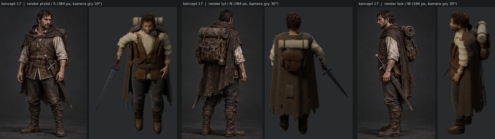
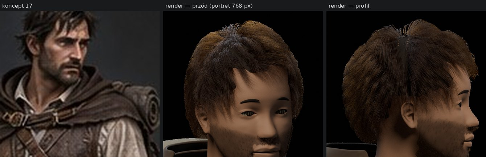

# Review bohatera — pass detali `detale-01`

**Data:** 27 października 2026 r. · **Przedmiot:** gałąź `vibe/sprite-bohater-codex` @ `421c7e8`, źródło `source/bohater_detale.blend` (SHA `bfa71374…`) · **Odniesienie:** [koncept 17](../../koncepty/17-bohater-i-woz.md), [kontrakt renderu](../KONTRAKT-RENDERU.md).

**Werdykt: nie nadaje się na wzór postaci.** Pipeline jest wzorowy, ale model odbiega od konceptu w większości rozpoznawalnych cech, materiały czytają się jak plastik, a warstwy stroju masowo przenikają się nawzajem. Uwagi autora (plastikowość, twarz, przenikania, brak prawdziwych tekstur) potwierdzają pomiary w pliku `.blend` — szczegóły niżej.

*Render ma kamerę gry 30° nad horyzontem, koncept — widok z poziomu oczu; to tłumaczy skrót perspektywy, ale nie różnice w stroju, głowie i proporcjach.*

## Co jest dobre i ma zostać

- Kontrakt renderu spełniony co do wartości: kamera, skala 60 px/m, kotwica, światło, AgX, Blender 4.3, osobny cień, 8 kierunków bez odbić.
- Odtwarzalność: renderer tylko czyta `.blend`, audyt SHA, zapakowane obrazy, powtórzony render daje identyczne piksele.
- Uczciwy opis ograniczeń w `DETAIL_REVIEW.md` (sam przyznaje stylizowaną twarz i brak testu przenikań płaszcza).

## 1. Zgodność z konceptem — główne rozbieżności

| Element | Koncept 17 | Model `detale-01` |
|---|---|---|
| Wiek i twarz | mężczyzna ok. 35–40 lat, mocna żuchwa, wyraźne kości policzkowe i łuki brwiowe, zmarszczki, kilkudniowy zarost | młodzieńcza, gładka twarz manekina; brwi to dwie bryły po 18 ścian; zarost czyta się jak ciemna plama |
| Włosy | krótkie, ciemne, potargane, zaczesane do tyłu i na bok | puszysta, kręcona czupryna z rudawymi końcami; w profilu ciemny pas (szczelina) przez czubek głowy |
| Kaptur i peleryna | miękki kaptur i krótka peleryna opadająca na barki | „opuszczony kaptur” to sztywna skorupa za karkiem, bez opadania na ramiona |
| Płaszcz | długi, poszarpany, układa się w pionowe fałdy od ramion | z tyłu płaska tafla bez drapowania; postrzępiony tylko dolny brzeg; łata wygląda jak prostokątna płytka |
| Koszula | jasny len, rękawy podwinięte do łokci, odkryte przedramiona, rozpięty kołnierz | pełne, bufiaste rękawy; na nadgarstkach jasne obręcze (owijki) świecące w skali 1×; kołnierz to gładki torus |
| Kaftan i pasy | skórzany kaftan z panelami i przeszyciami, dwa skrzyżowane rzemienie, dwa pasy z sakwami | gładki, otwarty kaftan bez paneli, jeden ukośny rzemień |
| Plecak | duży skórzany plecak z klapami, sprzączkami i manierką; posłanie na górze | mała okrągła sakwa; posłanie jasne, czyste, z idealną spiralą — najjaśniejszy element postaci |
| Miecz | w pochwie przy lewym biodrze | stale dobyty w prawej dłoni, ostrze odstaje w dół i w bok — dominuje sylwetkę 1× |
| Buty | wysokie do kolan, z paskami i wywiniętą cholewą | niskie, bulwiaste trzewiki |
| Postawa | wyprostowany, barki cofnięte, ręce swobodnie | przygarbiony, głowa wysunięta, ręce odstają, dłoń rozczapierzona na udzie; sylwetka „gruszki” |
| Brud i wilgoć | błoto na butach i spodniach, mokry płaszcz | praktycznie czysty strój |

Rozstrzygnięcia autora potrzebne przed poprawkami: czy w eksploracji miecz jest w pochwie (jak na koncepcie), a dobywany tylko w walce.

## 2. Twarz i głowa

- Głowa to siatka MakeHuman z delikatnie wzmocnioną żuchwą i nosem — bez rzeźby wieku, kości i mimiki.
- **Skóra nie ma tekstury twarzy**: materiał używa jednolitej, kafelkowalnej próbki 512×512 ([`skin_traveler_weathered_basecolor.png`](../../../assets/textures/characters/hero/skin_traveler_weathered_basecolor.png) — beżowy szum) rzutowanej przez UV „w metrach”. Brak koloru ust, zaczerwienień, cieni oczodołów i zarostu w teksturze. Rozproszenie podpowierzchniowe (SSS) 0,075 — skóra wygląda jak glina.
- Oczy i tęczówki to materiał proceduralny; brak rogówki i cienia powiek.

## 3. Materiały — skąd „plastik”

Wszystkie tkaniny i skóry (len, wełna, kaftan, rzemienie, buty, plecak, posłanie) korzystają z **tych samych ogólnych próbek 512×512**, powtarzanych przez UV w metrach, z maskami przetarć i błota nałożonymi tak samo na każdą część. 98 obiektów ściegów ma osobny materiał proceduralny.

Brakuje tego, co odróżnia uszyte ubranie od plastiku:

- tekstur **unikatowych dla części stroju** (UV rozłożone na element, nie rzut metryczny),
- **wypalonych map** okluzji (AO) i krzywizny — ciemnych zagłębień w fałdach i przetarć na krawędziach,
- gradientu brudu **od ziemi w górę** (buty, nogawki, dół płaszcza) i wilgoci przy brzegach,
- kontrastu walorów: jasny len i posłanie są najjaśniejsze w kadrze, a w koncepcie strój jest ciemny, z jasną koszulą tylko na piersi i rękawach.

## 4. Przenikania — pomiar

Sprawdzone narzędziem [`tools/art/check_intersections.py`](../../../tools/art/check_intersections.py) na `bohater_detale.blend`, akcja `spoczynek`, klatka 1, siatki po modyfikatorach:

**220 par obiektów i 34 772 przecinające się pary trójkątów** (po odjęciu zamierzonego styku oka z głową). Najgorsze:

| Trójkąty | Para obiektów |
|---:|---|
| 2612 | Krótki płaszcz ↔ Naramienna warstwa płaszcza |
| 1810 | Krótki płaszcz ↔ Opuszczony kaptur |
| 1443 | Kaftan ↔ Lniana tunika |
| 1106 | Naramienna warstwa płaszcza ↔ Opuszczony kaptur |
| 1001 | Krótki płaszcz ↔ Lniana koszula (rękawy) |
| 799 | Brzeg koszuli pod kaftanem ↔ Spodnie |
| 768 | Kaftan ↔ Opuszczony kaptur |
| 723 | Kaftan ↔ Lniana koszula (rękawy) |
| 371 | Krótki płaszcz ↔ Plecak |
| 245 | Głowa i szyja ↔ Krótki płaszcz |

Dotychczasowe raporty bohatera (`intersection-validation.json`) badały tylko miecz z siedmioma siatkami i dolną połę płaszcza ze spodniami, dlatego pokazywały zera. Warstwy stroju między sobą nie były sprawdzane.

## 5. Budowa modelu i szkielet jako wzór

- 207 osobnych siatek (29 tys. ścian przed wygładzaniem); każda warstwa stroju składa się z wielu kawałków, a pod ubraniem nie ma ciała — tylko głowa, szyja i przedramiona. Takiego stroju nie da się przenieść na inną postać ani kontrolować kolizji tkanin.
- Szkielet ma 17 kości: **brak obojczyków, palców, kości skrętnych przedramion, palców stóp i twarzy**. Do zamachu toporem Drwala, chwytu Powrotnika czy parowania mieczem bohatera to za mało.
- Dwa źródła: `bohater.blend` (rewizja 08, z animacjami i atlasami gry) i `bohater_detale.blend` (statyczny pass). Atlasy gry pokazują starszy wygląd. Przed animacją trzeba je scalić w jedno źródło.

## 6. Plan naprawy (wzór postaci ludzkiej)

1. **Ciało bazowe:** pełne ciało mężczyzny 35–40 lat, atletycznego, o proporcjach z konceptu — np. MPFB (MakeHuman dla Blendera, zasoby CC0) — z teksturą skóry obejmującą twarz. Ten sam rdzeń posłuży innym ludziom.
2. **Szkielet:** pełny rig humanoida (np. Rigify) z obojczykami, palcami, skrętem przedramion i stopą z palcami; wagi malowane na pełnym ciele.
3. **Głowa:** rzeźba wieku i rysów według konceptu; brwi i zarost z włókien oraz w teksturze; włosy krótkie, ciemne, potargane i zaczesane jak na koncepcie.
4. **Strój od nowa, warstwami:** koszula → kaftan → pasy i sakwy → kaptur z peleryną → płaszcz. Każda warstwa to jedna siatka z grubością; peleryna, kaptur i płaszcz układane symulacją tkaniny Blendera na ciele (z kolizjami), potem fałdy rzeźbione. Plecak, buty i pochwa zgodnie z konceptem.
5. **Tekstury:** rozłożone UV dla każdej części, wypalone AO, krzywizna i wysokość; tekstura 2K na część, łącząca bibliotekę materiałów z unikatowym zużyciem (przetarcia krawędzi, błoto od ziemi do kolan, wilgoć przy dole płaszcza). Skóra twarzy z SSS ok. 0,2–0,3.
6. **Kontrola:** `check_intersections.py` dla spoczynku i każdej klatki chodu; cel — zero przenikań między warstwami tkanin, a dozwolone styki (oczy, obszycia na podłożu) wymienione jawnie w `--allow`.
7. **Akceptacja statyki przed animacją:** plansza koncept ↔ render (przód, tył, bok), osiem kierunków w 1× na tle lasu, zbliżenie twarzy. Dopiero po akceptacji autora — ponowne animacje i atlasy z jednego źródła.

## Uwaga o metodzie pracy

Wykonawca bohatera wyróżnia się inżynierią: kontrakt, audyty, odtwarzalność. Problemy dotyczą rzeźby, drapowania tkanin i malowania tekstur, czyli pracy artystycznej, którą trudno uzyskać samymi skryptami składającymi bryły. Warto rozważyć: (a) gotową bazę CC0 (MPFB) i symulację tkanin zamiast ręcznie składanych brył albo (b) udział artysty 3D przy głowie i stroju, z zachowaniem obecnego pipeline'u renderu. Decyzja należy do autora.
