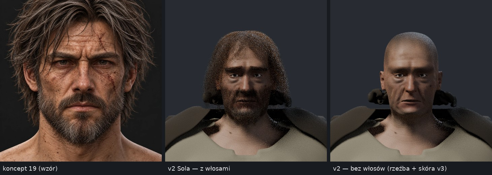

# Review bohatera — v2 (F0–F3)

**Data:** 27 października 2026 r. · **Przedmiot:** gałąź `vibe/sprite-bohater-codex` @ `c51bc52`, źródło `source/bohater_v2.blend` (SHA `6947b81d…`, rewizja `v2-F3-equipment-review-16`) · **Odniesienie:** [plan naprawy](PLAN-NAPRAWY-BOHATERA.md), [koncept 17](../../koncepty/17-bohater-i-woz.md), [koncept 19](../../koncepty/19-bohater-twarz.md), [poprzednie review](REVIEW-BOHATER-01.md).

**Werdykt: fundament przyjęty (B1), wygląd odrzucony (B2).** Ciało, szkielet, UV i dyscyplina techniczna są wzorowe. Głowa, włosy i strój nie osiągają poziomu konceptów; tekstury stroju tego nie naprawią, bo to problemy bryły, nie malowania.

*Zbliżenie w świetle kontraktu: koncept 19, v2 z włosami, v2 bez włosów (rzeźba i skóra GPT 6 v3).*

## Co jest dobre i zostaje

- **Ciało i szkielet:** pełna siatka MakeHuman z natywnym UV (maks. różnica 3·10⁻⁸), 163 kości z pełnymi wagami, sześć póz testowych bez zapadnięć. **Bramka B1 przyjęta.**
- **Przenikania:** z 34 772 par trójkątów w detale-01 do 0 niedozwolonych. Pomiar PM (`tools/art/check_intersections.py`) daje identyczny wynik: 7 par / 974 pary trójkątów, wyłącznie oczy pod powiekami i głowica w rękojeści.
- **Technika:** jedno źródło, render powtarzalny co do piksela, kompletne przekazanie P2 (154 PNG z SHA), uczciwy raport `V2_REVIEW.md` — sam wskazuje głowę i sylwetkę jako otwarte.

## Co nie przechodzi (B2)

| Element | Koncept | v2 |
|---|---|---|
| Wyraz twarzy | surowy: brwi ściągnięte w dół, zmarszczka gniewna | brwi uniesione w środku, opadnięte kąciki ust — wyraz smutny, zalękniony |
| Kształt twarzy | szeroka, kwadratowa żuchwa | twarz wąska i wydłużona |
| Włosy | potargane kosmyki do żuchwy, siwe pasma | ok. 34 tys. cienkich, równych włókien: szum i „hełm” z prześwitem skóry |
| Zarost | gęsta, krótka broda, siwy podbródek | brudna smuga |
| Kaptur | miękko opada na barki | zwinięty brzeg wystaje po obu stronach żuchwy jak ciemne grudy |
| Strój | panele, przeszycia, fałdy, wywinięte cholewy | bryły z kilkudziesięciu do kilkuset ścian wygładzone Subsurf (sakwa 98, rzemień 80): kaftan-prostokąt, sakwy-kostki, buty-rury bez kostki, płaskie wycięcie koszuli z ząbkiem, płaszcz-płachta |
| Czytelność 1× | twarz i miecz prowadzą wzrok | ciemna figura z beżową plamą koszuli; plecak jak skrzynka; N/NE/NW — ciemny prostokąt |

## Decyzje i dalszy tok

- **Wygląd bohatera przejmuje Claude** na gałęzi `vibe/bohater-claude` od `c51bc52` (zgoda autora 27.10.2026; zob. [rejestr](../../WYKONAWCY.md)). Bierze ciało, szkielet, UV, skórę i narzędzia kontroli; przebudowuje głowę, włosy, zarost, kaptur i krój stroju.
- Metoda: bramki z planszą porównawczą obok konceptu i pomiarem sylwetki po każdym etapie, według skilla [`donth77/blender-game-skills`](https://github.com/donth77/blender-game-skills) (MIT) — zgoda autora na jego skrypty. Strój z wykrojów zszywanych symulacją tkaniny; włosy w kosmykach.
- **Etapy:** G1 głowa (portret i zbliżenie 1× obok konceptu 19) → G2 sylwetka stroju (przód, bok, tył obok konceptu 17, 8 kierunków 1×) → G3 nowe P2 dla GPT 6, potem B2. Każdą bramkę akceptuje autor; wykonawca nie ocenia sam siebie.
- **GPT 6:** skóra i oko dalej (UV ciała bez zmian). **Część B briefu (strój) wstrzymana** do G2 — UV stroju się zmienią.
- **Sol:** praca nad bohaterem wstrzymana; dalszy zakres do decyzji autora.
