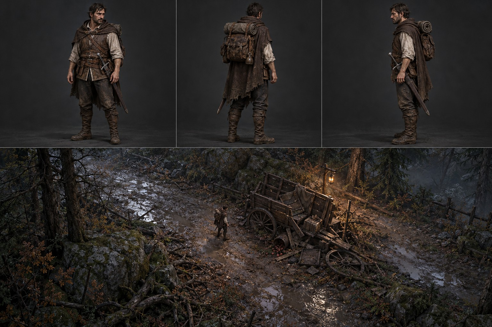

# Bohater na początku przygody — referencja wizualna

**Status:** ilustracja koncepcyjna przygotowana na prośbę autora, 27 października 2026 r. Punkt odniesienia dla wykończenia postaci i nastroju sceny; nie jest renderem z gry, sprite'em ani zatwierdzoną specyfikacją techniczną.

## Bohater

Przypadkowy podróżnik, nie wybraniec ani rycerz. Plansza pokazuje przód, tył i bok: naturalną ludzką sylwetkę, jasną lnianą koszulę, ciemne spodnie i buty, warstwy skóry i tkaniny, płaszcz, miecz, plecak oraz zwinięte posłanie. Paleta ziemista, materiały matowe i zróżnicowane, ubranie umiarkowanie zabrudzone deszczem i błotem. Wykończenie ma wspierać istniejący kierunek prototypu, a nie narzucać identycznych rysów twarzy lub każdego paska.

W skali gry priorytetem są czytelna sylwetka, nogi, pakunek i broń; szczegóły widoczne na dużych ujęciach mogą zniknąć po zmniejszeniu. Sprawdzić miecz i materiały w ośmiu kierunkach, w ruchu i na ciemnym tle. Koncept nie potwierdza rozmiaru, kąta kamery, oświetlenia ani jakości animacji w działającej grze.

## Scena przy wozie

Dolny kadr sugeruje mokry trakt, ciemny las, kamienie, korzenie, rozproszone pakunki i kontrast chłodnego otoczenia z ciepłym punktem światła. To nastrojowa propozycja kompozycji, a nie mapa kolizji, gotowa lokacja ani dokładny zrzut ekranu. Przejścia wokół wozu i miejsce do uniku należy sprawdzić w prototypie.

**Uwaga fabularna:** zatwierdzona [fabuła](../demo-fabula.md) mówi, że przy wozie koń jeszcze żyje; na planszy go nie pokazano. Pierwsza wizyta przy wozie bez aktywnego starcia oraz późniejsza walka z Psem są opisane jako propozycja w [początku gry](../pakiet-04-poczatek.md). Obraz nie rozstrzyga stanu konia, położenia latarni ani układu terenu.

Grafika wygenerowana w ChatGPT jako referencja wizualna; nie zawiera osobnych warstw, modelu ani źródeł renderu. Technologia produkcji pozostaje otwarta.
