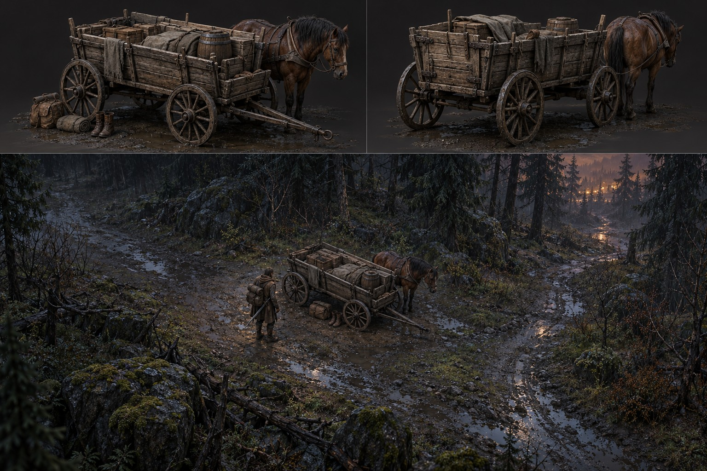
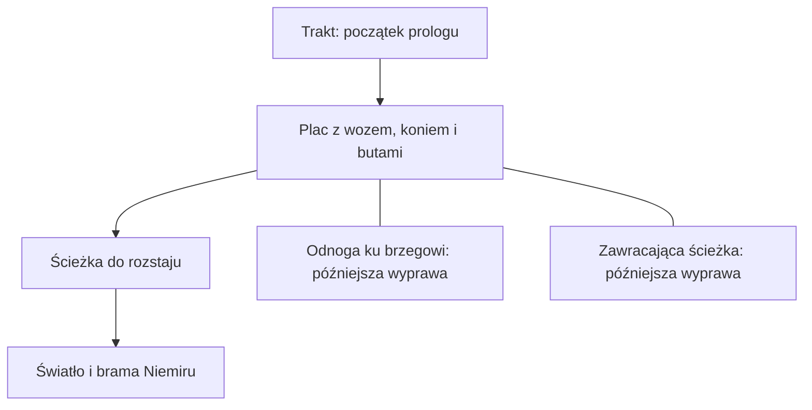

# Skraj lasu i wóz — propozycja pierwszej sceny

**Status:** robocza propozycja wizualna i przestrzenna, 27 października 2026; do oceny autora i walidacji w prototypie. Grafika wygenerowana w ChatGPT. Nie jest modelem 3D, assetem gry, ani pomiarem przejść. Dokumentowana ilustracja nie ustala nowych faktów o świecie.

## Punkt wyjścia

W [zaakceptowanej fabule](../demo-fabula.md) po trzech dniach deszczu podróżnik znajduje wóz, żywego konia, pakunki, ślady walki i buty ustawione równo przy drodze. [Propozycja prologu](../pakiet-04-poczatek.md) przewiduje pierwszą wizytę bez aktywnej walki, drogę ku światłu i bramie oraz powrót rankiem. [Mapa](../pakiet-04-mapa.md) przewiduje dwie drogi obejścia wozu i połączenie z rozstajem, brzegiem oraz zawracającą ścieżką; te szczegóły podlegają walidacji.

## Układ funkcjonalny — propozycja do blockoutu

Schemat obrazuje zależności, nie kierunki świata, rzeczywiste odległości ani ekranowe położenie obiektów.

- Wóz stanowi punkt orientacyjny; po obu jego bokach należy pozostawić ciągłe drożne przejścia. Rysunek nie dowodzi, że istnieją w praktyce: koń, dyszel, rekwizyty i korony mogą je zasłonić.
- Koń i buty są widoczne przy pierwszym podejściu. Jasny pakunek pozostaje czytelny z kamery; jego dokładne położenie to propozycja.
- Światło w kierunku bramy ma wskazywać dalszą drogę. Ilustracja przedstawia rozległą odległą łunę: **nie jest to ustalenie wyglądu, położenia ani widoczności osady**; w projekcie należy sprawdzić skromny punkt światła między drzewami.
- Rozstaw drzew i kamieni powinien zostawiać miejsce na unik i umożliwiać widoczność postaci oraz przeciwnika przy późniejszej wyprawie. Pierwszy kontakt z wozem nie jest automatycznie starciem.
- Stan konia, pakunków i wozu powinien pozostać spójny przy powrotach. Ich dokładna interaktywność pozostaje do zaprojektowania.

## Wóz — kierunek modelu

Prosty, użytkowy wóz towarowy: drewniana skrzynia z desek na podwoziu, cztery koła szprychowe, osie i dyszel, ciemne żelazne okucia. Mokre, zróżnicowane drewno i przetarcia powinny być czytelne przy stonowanym świetle. Pakunki, buty, koń i cień należy przygotować jako oddzielne elementy sceny, a nie wpiekać w sprite wozu.

Mechanika zaprzęgu na grafice jest niejednoznaczna: pozycję konia i sposób połączenia z dyszlem należy zaprojektować poprawnie w modelu, bez kopiowania obrazu dosłownie. Nie ustalono, czy wóz jest uszkodzony ani które elementy powinny się ruszać. Te szczegóły są otwarte.

## Skala i testy

Nie ustalamy arbitralnych metrów ani szerokości przejść. Zgodnie z [metrykami mapy](../pakiet-04-mapa.md) najpierw mierzymy obrys bohatera D, przeciwnika B, dystans uniku U i widoczny obszar V. Blockout ma następnie sprawdzić:

1. Oba przejścia przy wozie są osiągalne i wystarczająco szerokie dla bohatera oraz właściwych przeciwników, z marginesem na sterowanie.
2. Tor uniku i miejsce startu oraz zakończenia są wolne od kolizji; wóz i zaprzęg nie tworzą ślepych zakamarków.
3. Buty, koń, pakunek i kierunek do światła są rozpoznawalne z docelowej kamery; korony drzew nie zasłaniają działań.
4. Kliknięcie w oba obejścia prowadzi poprawnie, a wóz odpowiednio blokuje ruch i pociski, jeśli wymagają tego przyjęte zasady.
5. Przejście wóz → rozstaj → brama działa płynnie bez ekranu ładowania podczas normalnego ruchu; sposób doczytywania pozostaje decyzją techniczną do prototypu.
6. Pętla drogi i powroty zachowują stan świata i nie przenoszą aktywnej walki. Rozwiązanie przejścia wymaga osobnego eksperymentu.

**Wynik:** powyższych testów nie wykonano; obraz nie jest testem kolizji ani pomiarem wydajności. Render obiektów obowiązuje zgodnie z [kontraktem renderu](../art/KONTRAKT-RENDERU.md); silnik gry pozostaje otwarty.

Powiązane: [bohater](17-bohater-i-woz.md), [biblioteka konceptów](README.md), [plan mapy](../pakiet-04-mapa.md).
