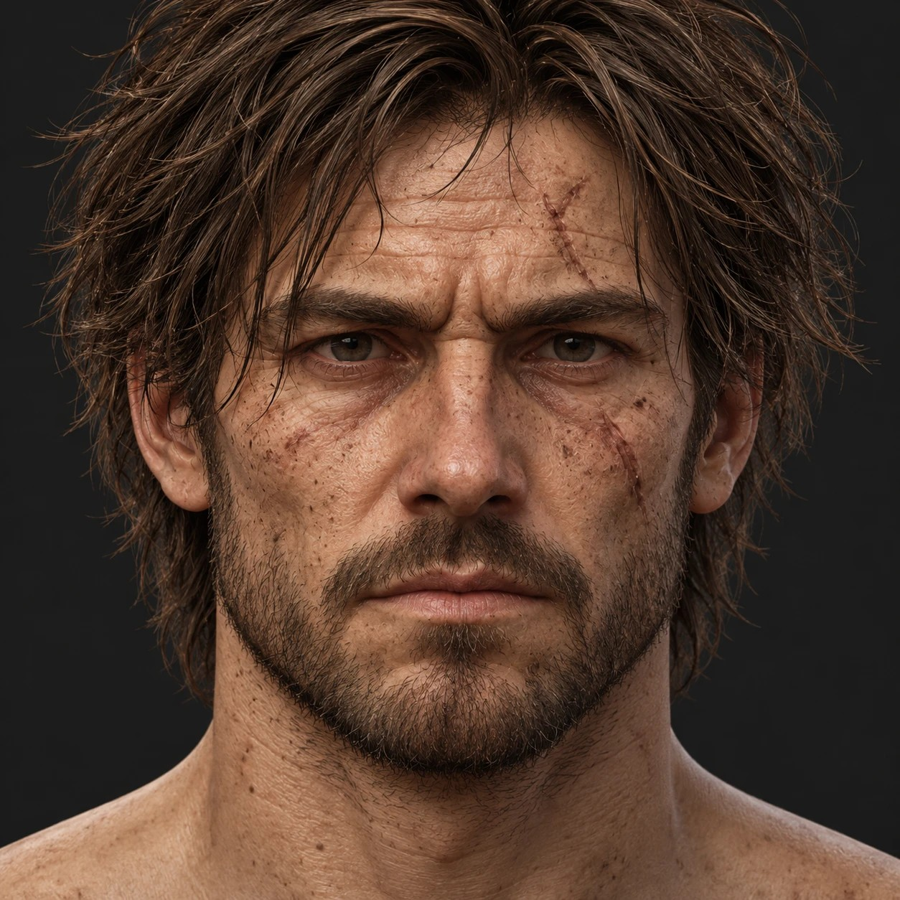

# Bohater — twarz (koncept od grafika)

**Status:** referencja wyglądu twarzy od grafika, przekazana przez autora 27 października 2026 r. Punkt odniesienia dla rzeźby głowy i tekstury skóry bohatera; nie jest renderem z gry ani teksturą.

## Co pokazuje

- **Twarz** dojrzałego, zmęczonego drogą mężczyzny: ciężkie łuki brwiowe, zmarszczka gniewna między brwiami, głębokie poziome bruzdy czoła (nieregularne, przerywane), kurze łapki, worki i cienie pod oczami, bruzdy nosowo-wargowe.
- **Skóra** ogorzała, ciepła, czerwonawa na nosie i policzkach; liczne piegi i plamki słoneczne na czole, policzkach i szyi; widoczne pory.
- **Blizny:** świeżo zagojone, **różowoczerwone, nierówne, lekko wypukłe** — skośna blizna przez czoło nad lewą brwią postaci (z krzyżującym się krótszym cięciem) i skośna blizna na lewym policzku pod okiem; drobniejsze zadrapania na prawym policzku. Nie są wgłębieniami w skórze.
- **Zarost:** gęsty, kilkudniowy do krótkiej brody, ciemnobrązowy, z wąsem; linia na policzkach nieregularna, schodzi na szyję stopniowo.
- **Włosy:** ciemnobrązowe, **średniej długości** (do linii żuchwy), potargane, pasma opadają na czoło i uszy.

## Uwagi dla wykonawców

- Twarz z tego konceptu ma pierwszeństwo przed twarzą z planszy [17](17-bohater-i-woz.md) przy rzeźbie głowy i teksturze skóry; strój nadal według planszy 17.
- **Do decyzji autora:** koncept pokazuje włosy średniej długości bez siwizny, a [plan naprawy](../art/characters/PLAN-NAPRAWY-BOHATERA.md) mówi o krótkich włosach przyprószonych siwizną.
- Koncept wygenerowano jako obraz; nie zawiera warstw, modelu ani źródeł renderu. Sprite'y produkujemy zgodnie z [kontraktem renderu](../art/KONTRAKT-RENDERU.md).
