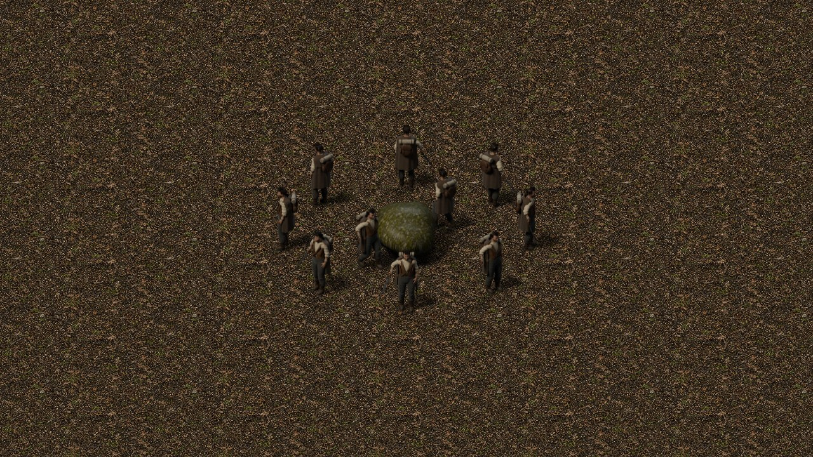
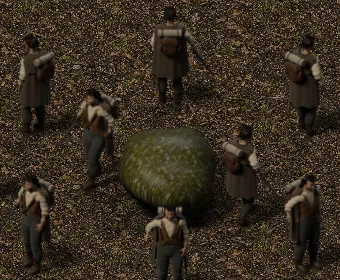

# Test zgodności assetów z Godotem

**Status: test techniczny, nie gra** (27 października 2026 r.). Sprawdza pierwszą część warunku z decyzji o silniku: czy sprite'y zrobione według [kontraktu renderu](../../docs/art/KONTRAKT-RENDERU.md) działają w Godocie bez przeróbek.





## Co jest w scenie

- Podłoże: `forest_litter_mixed.png` z biblioteki tekstur, 1024 px = 4 m, rzut 60 × 30 px na metr.
- Głaz `glaz` z gałęzi terenu, wyrenderowany kamerą i światłem z kontraktu (`tools/render_glaz.py`).
- Ośmiu stojących bohaterów, po jednym na kierunek, oraz dwóch chodzących wokół głazu; kierunek wynika z wektora ruchu.

## Wynik (Godot 4.7.2, renderer GL Compatibility, Mesa llvmpipe pod Xvfb)

| Sprawdzenie | Wynik |
|---|---|
| Kotwica z JSON (96; 158,35) zgodna z rzutem kamery | **tak**, co do ułamka piksela (`WELESZA_ANCHOR_CHECK ok=true`) |
| Osiem kierunków z atlasu, bez odbić | **tak**, każdy kierunek z własnego wiersza |
| Czas klatek z `durations_ms` | **tak**, 1000 kl./s × czas w ms |
| Zmiana kierunku w ruchu bez resetu fazy kroku | **tak** |
| Sortowanie po kotwicy: bohater za głazem zasłonięty, przed głazem na wierzchu | **tak** (nagranie) |
| Osobna warstwa cienia pod obiektami | **tak** |
| Alfa atlasu (nieprzemnożona) — brak ciemnych obwódek | **tak** |
| Pamięć tekstur całej sceny (2 animacje bohatera z cieniami, podłoże, głaz) | 71,4 MiB bez kompresji |
| Wywołania rysowania na klatkę | 13 |

## Czego ten test nie sprawdza

- świata bez ekranów ładowania (doczytywanie fragmentów w tle),
- okien walki z `events`, kolizji, nawigacji i wejścia gracza,
- przenikania dużych obiektów (drzewa, budynki) i sortowania obiektów o dużej podstawie — kotwica jednego punktu wystarcza dla głazu, nie dla domu,
- kompresji tekstur i przycinania pustych pól klatek,
- oświetlenia podłoża: tekstura podłoża jest czystym kolorem bez świateł z kontraktu, dlatego jest jaśniejsza niż sprite'y. Technika terenu pozostaje otwarta w kontrakcie.

Głaz jest renderem testowym: plik terenu był zapisany w Blenderze 5.0, więc wyrenderowano go w `bpy` 5.2.3, a nie w 4.3 wymaganym przez kontrakt. Po poprawkach na gałęzi terenu należy go podmienić.

## Uruchomienie

```bash
prototype/godot/tools/fetch_assets.sh          # atlas bohatera i podłoże z ich gałęzi
GODOT=Godot_v4.7.2-stable_linux.x86_64         # SHA-512 zgodne z SHA512-SUMS.txt wydania
cd prototype/godot
$GODOT --headless --path . --import
xvfb-run -a $GODOT --path . --rendering-driver opengl3 \
  --write-movie /tmp/klatki/k.png --fixed-fps 25 --quit-after 150
```

W konsoli pojawiają się wiersze `WELESZA_ANCHOR_CHECK`, `WELESZA_TEXTURE_MEM_MIB` i `WELESZA_DRAW_CALLS`. Z edytorem Godota wystarczy otworzyć `project.godot` i uruchomić scenę.

Bohater: `vibe/sprite-bohater-codex` @ `09180d3`; podłoże: `main` @ `6d348b2`.
